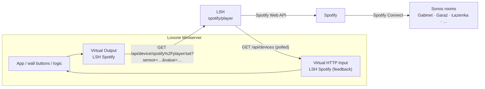

# Spotify in Loxone — wiring schematics

How to wire the LSH Spotify player (`spotify/player`) into Loxone Config: pick
a playlist, send the music to a room (Sonos speakers via Spotify Connect),
volume, play / pause, and show what's playing in the Loxone app.

Setup in LSH: **Settings → Spotify → Loxone** — choose and order the favourite
playlists and the speakers, **Save**, then **⬇ Spotify outputs.xml** and
**⬇ Spotify inputs.xml**. In Loxone Config import them under *Virtual
Outputs* and *Virtual HTTP Inputs* (template import). Reference:
[README → Spotify in Loxone](../README.md#spotify-in-loxone).

The numbers below assume this order (change them to match yours):

| # | Favourite playlist | | # | Speaker |
|---|---|---|---|---|
| 1 | Poranek | | 1 | Gabinet |
| 2 | Polish Jazz | | 2 | Garaż |
| 3 | Dzieci | | 3 | Łazienka |
| 4 | Impreza | | 4 | Łazienka Piętro |
| | | | 5 | Pralnia |
| | | | 6 | Strefa zabawy |
| | | | 7 | Toaleta |
| | | | 8 | Tobiasz |
| | | | 9 | Tymek |

---

## Rooms and their Loxone commands

What's in the imported *LSH Devices* Virtual Output, per room. The Sonos
commands drive that room's speaker directly (whatever it plays); the Spotify
commands move Spotify's music to it.

| Room | Sonos commands (Virtual Output) | Spotify pulse | Spotify Speaker # |
|---|---|---|---|
| Gabinet | Gabinet Play · Gabinet Next · Gabinet Previous · Gabinet Volume · Gabinet Mute | Spotify → Gabinet (`to_gabinet`) | 1 |
| Garaż | Garaż Play · Garaż Next · Garaż Previous · Garaż Volume · Garaż Mute | Spotify → Garaż (`to_garaz`) | 2 |
| Łazienka | Łazienka Play · Łazienka Next · Łazienka Previous · Łazienka Volume · Łazienka Mute | Spotify → Łazienka (`to_lazienka`) | 3 |
| Łazienka Piętro | Łazienka Piętro Play · Łazienka Piętro Next · Łazienka Piętro Previous · Łazienka Piętro Volume · Łazienka Piętro Mute | Spotify → Łazienka Piętro (`to_lazienka_pietro`) | 4 |
| Pralnia | Pralnia Play · Pralnia Next · Pralnia Previous · Pralnia Volume · Pralnia Mute | Spotify → Pralnia (`to_pralnia`) | 5 |
| Strefa zabawy | Strefa zabawy Play · Strefa zabawy Next · Strefa zabawy Previous · Strefa zabawy Volume · Strefa zabawy Mute | Spotify → Strefa zabawy (`to_strefa_zabawy`) | 6 |
| Toaleta | Toaleta Play · Toaleta Next · Toaleta Previous · Toaleta Volume · Toaleta Mute | Spotify → Toaleta (`to_toaleta`) | 7 |
| Tobiasz | Tobiasz Play · Tobiasz Next · Tobiasz Previous · Tobiasz Volume · Tobiasz Mute | Spotify → Tobiasz (`to_tobiasz`) | 8 |
| Tymek | Tymek Play · Tymek Next · Tymek Previous · Tymek Volume · Tymek Mute | Spotify → Tymek (`to_tymek`) | 9 |

Each command and what it does:

| Command (title in Loxone) | Type | Value | What it does | LSH call |
|---|---|---|---|---|
| **‹Room› Play** | digital | 1 / 0 | 1 = play, 0 = pause that room's Sonos | `/api/device/sonos%2F‹ip›/set?sensor=playing&value=1` |
| **‹Room› Next** | pulse | — | next track in that room | `…/set?sensor=next&value=1` |
| **‹Room› Previous** | pulse | — | previous track in that room | `…/set?sensor=prev&value=1` |
| **‹Room› Volume** | analog | 0–100 | that room's volume, % | `…/set?sensor=volume&value=<v>` |
| **‹Room› Mute** | digital | 1 / 0 | 1 = mute, 0 = sound back (volume kept) | `…/set?sensor=mute&value=1` |
| **Spotify Play** | digital | 1 / 0 | 1 = play / resume Spotify, 0 = pause (wherever it plays) | `/api/device/spotify%2Fplayer/set?sensor=playing&value=1` |
| **Spotify Next** | pulse | — | next song in Spotify | `…/set?sensor=next&value=1` |
| **Spotify Previous** | pulse | — | previous song in Spotify | `…/set?sensor=prev&value=1` |
| **Spotify Volume** | analog | 0–100 | volume of the speaker Spotify plays on | `…/set?sensor=volume&value=<v>` |
| **Spotify Shuffle** | digital | 1 / 0 | shuffle on / off | `…/set?sensor=shuffle&value=1` |
| **Spotify Playlist** | analog | 0…N | 0 = pause, N = start favourite playlist N | `…/set?sensor=playlist&value=<v>` |
| **Spotify Speaker** | analog | 0…9 | N = move Spotify to room N from the table above (0 = nothing) | `…/set?sensor=speaker&value=<v>` |
| **Spotify → ‹Room›** | pulse | — | move Spotify to that room and play | `…/set?sensor=to_‹room›&value=1` |

Every URL also carries `&token=<API token>`; the imported templates already
have it. `‹ip›` is the Sonos speaker's address with `_` instead of `.`
(`sonos%2F192_168_1_40`) — the import fills it in. The Spotify pulses and
*Spotify Playlist / Speaker* appear after the lists are saved in
**Settings → Spotify → Loxone** and the Spotify templates are downloaded again.

**Sonos vs Spotify for the same room:** *Gabinet Play* resumes whatever the
Gabinet Sonos had (radio, line-in, Spotify…); *Spotify → Gabinet* takes your
Spotify session — from a phone or another room — and moves it to Gabinet.

---

## 0 · Overview



| Virtual Output command | Kind | Value |
|---|---|---|
| Spotify Play | digital | 1 = play, 0 = pause |
| Spotify Next / Previous | pulse | |
| Spotify Volume | analog | 0–100 |
| Spotify Shuffle | digital | |
| Spotify Playlist | analog | 0 = pause, 1…N = favourite N |
| Spotify Speaker | analog | 1…N = move to speaker N (0 = do nothing) |
| Spotify → Gabinet, → Garaż, … | pulse | move there and play |

| Virtual HTTP Input | Value |
|---|---|
| Spotify Play | 1 playing / 0 not |
| Spotify Volume | 0–100 (of the speaker playing) |
| Spotify Shuffle | 1 / 0 |
| Spotify Playlist | favourite playing, 0 = something else / nothing |
| Spotify Speaker | speaker playing, 0 = another device |

---

## 1 · Playlist selector

One analog value picks the playlist. A *Radio Buttons* block gives exactly that
(its output is the number of the selected option, 0 = none). Name the options
like the favourites so the app shows names.

```
                    ┌──────────────────────────┐
  App / buttons ───►│  Radio Buttons           │
                    │  "Spotify playlista"     │
                    │  1 Poranek               │
                    │  2 Polish Jazz           │  AQ (0…4)   ┌─────────────────────┐
                    │  3 Dzieci                ├────────────►│ VO Spotify Playlist │
                    │  4 Impreza               │             └─────────────────────┘
                    │  0 = off → pause         │
                    └──────────────────────────┘
                                 ▲
   VI Spotify Playlist ──────────┘  (feedback: shows what's really playing —
                                    wire it to the block's set/value input if your
                                    Config version has one, otherwise to a Status
                                    block, see §5)
```

Choosing an option starts that playlist on the speaker currently playing
(or the *Default device* from Settings when nothing is active).

---

## 2 · One button per room

Each "→ room" command is a pulse: Spotify moves to that Sonos room and plays.
Ideal for a wall push-button or an app *Push button* per room.

```
  Push-button Gabinet  ──┐ (pulse)    ┌──────────────────────────┐
                         └───────────►│ VO Spotify → Gabinet     │
  Push-button Garaż    ──────────────►│ VO Spotify → Garaż       │
  Push-button Łazienka ──────────────►│ VO Spotify → Łazienka    │
  Push-button Tymek    ──────────────►│ VO Spotify → Tymek       │
          …                           └──────────────────────────┘
```

Alternative with one analog value (e.g. a second *Radio Buttons* block
"Spotify głośnik" with the 9 rooms):

```
  Radio Buttons "Spotify głośnik" ── AQ (1…9) ──► VO Spotify Speaker
  VI Spotify Speaker ──────────────────────────► feedback (which room plays)
```

The music follows the room — the playlist keeps playing, only the speaker
changes. A room that's off / not visible in Spotify Connect is refused (LSH log:
*Spotify can't see "…"*).

---

## 3 · Play / pause and skip

```
                   ┌───────────────────┐
  Wall button ────►│ Switch (Tr)       │ Q  ┌──────────────────┐
  (short press)    │ "Spotify"         ├───►│ VO Spotify Play  │
                   └───────────────────┘    └──────────────────┘
                            ▲
  VI Spotify Play ──────────┘  On / Off inputs — keeps the switch in step when
                               Spotify is started / paused from a phone

  Wall button ── double click ──► VO Spotify Next
  Wall button ── triple click ──► VO Spotify Previous
```

(Use a *Push-button+* / *Multi-click* block in front of the wall button to
split short / double / triple presses.)

---

## 4 · Volume

```
  App slider (Virtual Input, analog 0–100) ───────► VO Spotify Volume
  VI Spotify Volume ──────────────────────────────► slider value (feedback)

  Wall rocker:   [+] ──► Analog step +5 ─┐
                 [−] ──► Analog step −5 ─┴─► Analog Memory ──► VO Spotify Volume
                                    VI Spotify Volume ─┘ (as the memory's set value)
```

Volume always applies to the speaker that is playing. Keep a step of 5 or more
— every change is one call to Spotify.

---

## 5 · Showing it in the Loxone app

```
  VI Spotify Playlist ──► Status block "Spotify — playlista"
                              0 → "—"   1 → "Poranek"   2 → "Polish Jazz"
                              3 → "Dzieci"   4 → "Impreza"

  VI Spotify Speaker  ──► Status block "Spotify — gra w"
                              0 → "inne urządzenie"   1 → "Gabinet"   2 → "Garaż" …

  VI Spotify Play     ──► Status / Virtual State "Spotify gra" (on / off)
```

Track and artist names are text, which Loxone's HTTP inputs can't carry — they
show on the LSH dashboard instead.

---

## 6 · Scene: "Poranek w łazience"

Presence or the morning button in Łazienka starts the morning playlist there,
quietly, on weekdays only.

```
  Presence Łazienka ─┐
                     ├─► AND ─► Pulse ──┬──────────────────────────► VO Spotify → Łazienka
  Weekday 6:00–8:00 ─┘                  │
  (Calendar / Clock)                    ├─► Delay 2 s ─► Analog value 1 ──► VO Spotify Playlist
                                        │
                                        └─► Delay 3 s ─► Analog value 20 ─► VO Spotify Volume

  No presence 15 min ─► Pulse ─► VO Spotify Play = 0   (pause)
```

The delays give Spotify Connect time to switch the speaker before the playlist
and volume are sent.

---

## 7 · Scene: music follows you

Move playback to the room where someone is, without restarting the music.

```
  Presence Gabinet  ─► rising edge ─► Pulse ─► VO Spotify → Gabinet
  Presence Pralnia  ─► rising edge ─► Pulse ─► VO Spotify → Pralnia
  Presence Tymek    ─► rising edge ─► Pulse ─► VO Spotify → Tymek
           …
  only while VI Spotify Play = 1  (AND in front of each pulse)
```

---

## Troubleshooting

| Symptom | Cause |
|---|---|
| Nothing happens, LSH log *needs Spotify Premium* | Spotify only allows remote control with Premium |
| *No Spotify device is active* | Nothing is playing and no *Default device* is set — send a "→ room" pulse first |
| *Spotify can't see "Garaż"* | The Sonos room is off, grouped under another name, or not linked to Spotify — open the Spotify app → Devices and check the exact name |
| Feedback stays 0 | Playing something that isn't a favourite (playlist) or on a device that isn't in the list (speaker) — that's 0 by design |
| Numbers play the wrong playlist / room | The order in Settings changed after Loxone was wired — restore it, or re-wire |
